# Design and Implementation of an 8-bit Combinational Logic Unit in VHDL

**Student:** Anastasia Sharangia

**Course / instructor:** Digital Systems Lab  
**Submission date:** 14/11/2026

## 1. Objective and requirements

The project implements an unsigned 8-bit combinational logic unit (CLU) with two
operands A and B and a 3-bit operation selector. It supports addition, subtraction,
AND, OR, XOR, magnitude comparison, parity generation and one custom function.
The result is eight bits wide and is accompanied by Zero, Carry, Negative and
Less-than flags. The design is implemented in VHDL and targets a Cyclone V GX
Starter Kit. The assignment also requires a self-checking testbench, functional
waveform evidence, an FPGA implementation and a recorded demonstration.

Input storage is handled by the board wrapper, leaving the CLU datapath purely
combinational. The core is tested for every binary input combination, and a
separate testbench checks the board interface.

## 2. Operation and flag definitions

All arithmetic treats A and B as unsigned integers from 0 to 255. The result bus
contains the low eight bits of arithmetic results, equivalent to modulo 256.
The comparison encoding, parity layout, subtraction carry convention and custom
operation are explicit design choices because the assignment does not prescribe
their bit-level definitions.

| OP | Operation | Result definition | C definition |
|---|---|---|---|
| 000 | Addition | R=(A+B) mod 256 | Ninth addition bit |
| 001 | Subtraction | R=(A-B) mod 256 | 1 if A<B, meaning borrow |
| 010 | AND | Bitwise A AND B | 0 |
| 011 | OR | Bitwise A OR B | 0 |
| 100 | XOR | Bitwise A XOR B | 0 |
| 101 | Unsigned magnitude comparison | R=04 for A>B, 02 for A=B, 01 for A<B | 0 |
| 110 | Even-parity generation | R0=XOR(A7..A0), R1=XOR(B7..B0), R7..R2=0 | 0 |
| 111 | Custom rotation | Rotate A left by B(2:0), a count from 0 to 7 | 0 |

Z is 1 when the result is 00; N copies R7; LT is 1 when unsigned A<B, independently
of OP. In comparison mode the equality indicator is R1, not Z. For example,
comparing two equal operands gives R=02, so Z=0. N is the top result bit; it does
not change the unsigned interpretation of the operands and is not a signed
overflow flag.

The generated parity bit is 1 for an operand with an odd number of set bits.
Appending it makes the full word's parity even. Rotation moves bits that leave the
most significant end back into the least significant end. For example,
ROL(81,1)=03. Only B's low three bits are used, so B=09 also rotates by one.

## 3. Architecture and VHDL implementation

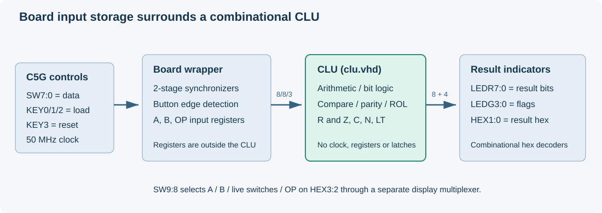

The design contains three synthesizable entities:

| Entity | Responsibility |
|---|---|
| `clu` | Combinational arithmetic, logic, comparison, parity, rotation and flags |
| `hex7seg` | Combinational active-low hexadecimal to seven-segment decoder |
| `clu_c5g_top` | Board input synchronizers, button edges, stored A/B/OP, display selection and pin-facing outputs |

The core uses `ieee.numeric_std` for explicit unsigned arithmetic. Its
`process(all)` recomputes the result whenever a read input changes. Variables are
assigned defaults before the operation case statement, every valid operation is
covered and a default case handles other selector values. R and every flag are
assigned on each evaluation, avoiding incomplete assignments and latch inference.
The core has no clock port, rising-edge tests or stored datapath values. For valid
binary inputs, its outputs depend only on the current A, B and OP.

Addition extends each operand to nine bits before adding, preserving carry out.
Subtraction is eight bits wide and wraps on underflow, with a separate unsigned
comparison producing the borrow flag. Parity uses a combinational XOR reduction
loop. The custom rotate operation synthesizes into selection logic.

### Board input interface

The C5G provides ten slide switches, fewer than the nineteen independent operand
and operation bits. SW7..SW0 form a shared data entry bus. KEY0 captures A, KEY1
captures B and KEY2 captures OP from SW2..SW0. KEY3 resets all stored values to zero.
These input registers are in the wrapper, outside the CLU. The C5G's user buttons
are active-low and hardware debounced according to the board manual.

The wrapper runs from the fixed 50 MHz X2 clock on pin R20. Two-stage
synchronizers sample switches and load buttons, and an edge detector captures
data once per button press. Reset asserts asynchronously and releases through
two clocked stages. Switch data must be stable before pressing a load button;
independent synchronizers do not guarantee coherent capture of a changing bus.

HEX1/HEX0 continuously display R in hexadecimal, and LEDR7..LEDR0 display R in
binary. LEDG0/1/2/3 show Z/C/N/LT; LEDG6..LEDG4 show OP2..OP0. LEDG7 is held on,
and LEDR8/9 are held off. SW9/SW8 select A, B, live switch data or OP for HEX3/HEX2.
The latter displays require the rear S1/S2 routing switches to be enabled because
their signals share GPIO pins.

## 4. Simulation and verification

Verification ran in Questa Altera Starter FPGA Edition 2025.2 using VHDL-2008.
`tb_clu.vhd` computes an independent expected result using integer arithmetic,
individual-bit truth conditions and integer parity/rotation calculations. It
asserts the result and all four flags for each vector. Directed cases include
minimum/maximum operands, carry, borrow, zero, all comparison relations, all parity
combinations, and rotations by 0, 1 and 7. A B value greater than seven also checks
the modulo-eight rotation convention.

The directed run applies 27 vectors, holding each for 10 ns. The exhaustive run
applies those 27 cases and then all 8 x 256 x 256 = 524,288 binary combinations,
for 524,315 checked vectors. The wait is a testbench observation interval, not an
assertion of FPGA propagation delay. This is a zero-delay functional RTL simulation.

`tb_clu_c5g_top.vhd` separately checks reset, loading operands and OP, no load
without a button, one capture while a button is held, all 256 data-byte values,
all hex digit patterns, display pages and representative flag/result behavior.
Both testbenches fail on mismatches. The runner verifies that every test reaches
its completion signal before producing its final pass status.

All three test suites passed, as shown in the table below.

| Test | Outcome | Simulated end time |
|---|---|---|
| Directed CLU | PASS, 27 vectors | 270 ns |
| Exhaustive CLU | PASS, 524,315 vectors including directed cases | 5,243,150 ns |
| C5G wrapper | PASS, control/display/input-value checks | 128,800 ns |

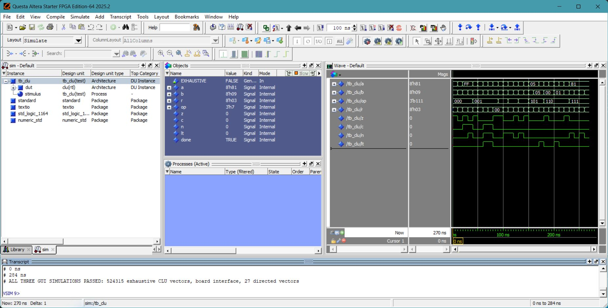

Directed waveforms are saved in `../evidence/clu_directed.wlf` and
`../evidence/clu_directed.vcd`. The plots below use this simulation data.

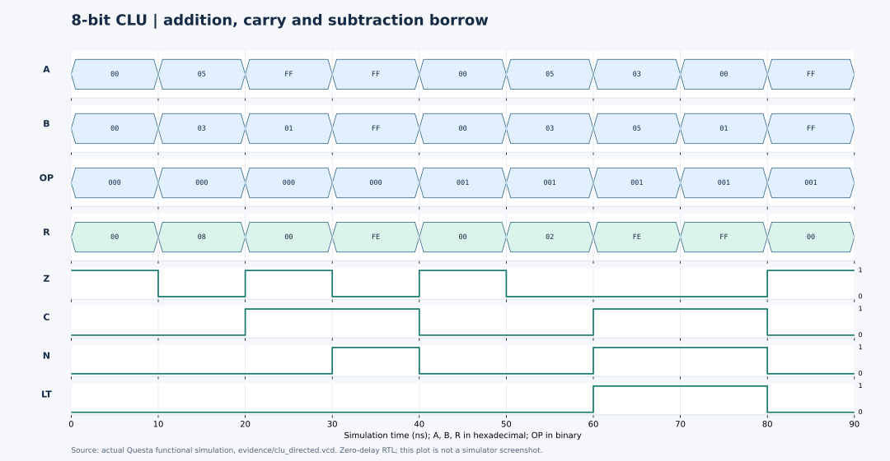

Figure 2. At 20-30 ns, FF+01 produces R=00, Z=1 and C=1. At 60-70 ns, 03-05
produces R=FE, C=1, N=1 and LT=1. The table and flags match the unsigned wraparound
and borrow conventions.

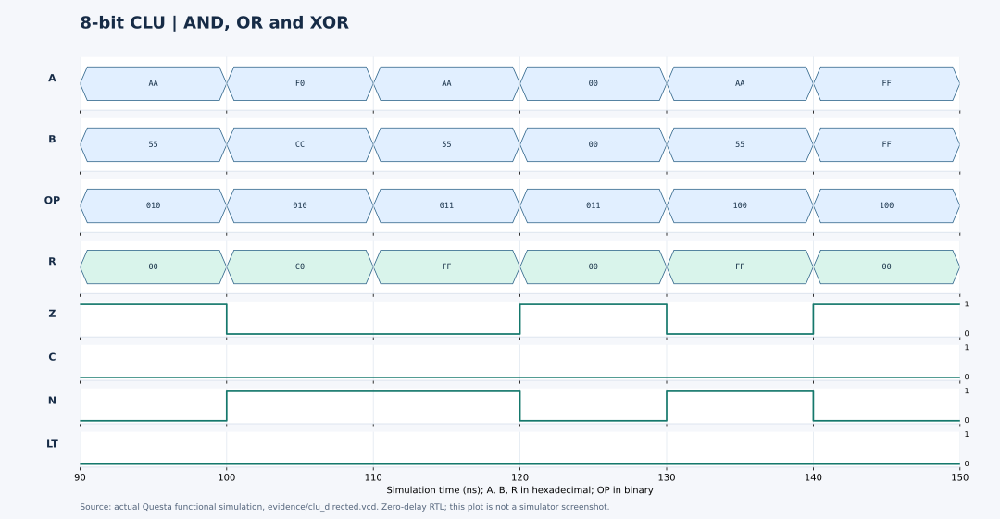

Figure 3. AND, OR and XOR are checked with complementary masks and equal operands.
For example, AA AND 55 gives 00; AA OR 55 and AA XOR 55 give FF; FF XOR FF gives 00.

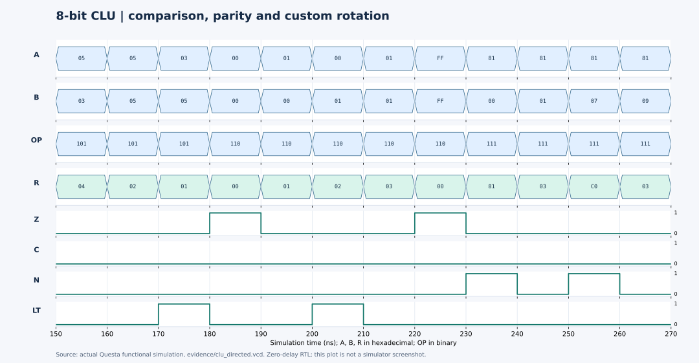

Figure 4. Comparison produces one-hot greater/equal/less codes. Parity outputs
occupy bits 0 and 1, and the rotation cases show wraparound and modulo-eight count.

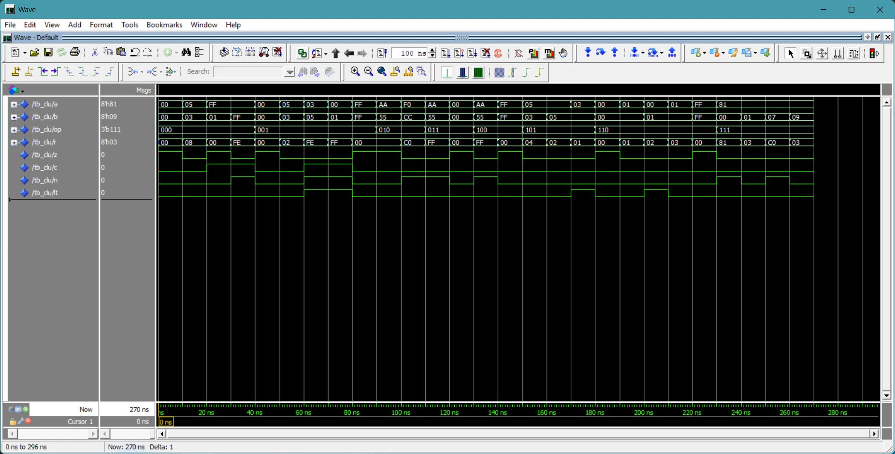

Figure 5. The complete 27-vector sequence in Questa. A/B/R are hexadecimal and OP
is binary.

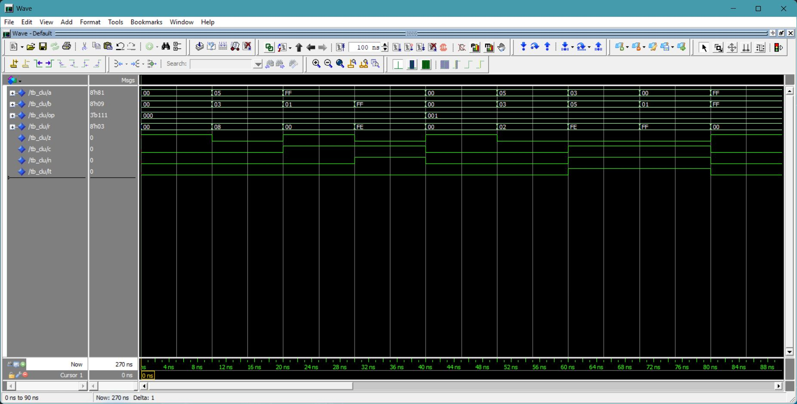

Figures 1, 5, 6 and 7 are application screenshots. Figures 8-12 have been enhanced
for readability.

## 5. FPGA compilation and timing

The project was fully compiled in Quartus Prime Lite 25.1std.0 Build 1129 for the
5CGXFC5C6F27C7. Pin locations and voltage standards come from the C5G user manual,
Tables 3-2 through 3-6, and are supplied in the QSF. All 61 used top-level pins have
explicit locations. Unused pins are reserved as tri-stated inputs.

The SDC defines a 20 ns wrapper clock period. Switch and button input paths are
declared asynchronous; paths between synchronizer registers remain timed.
Outputs have a designer-selected one-cycle settling budget. The LEDs are not
clocked receiving devices, so this budget is a design target rather than an
external synchronous interface specification.

| Measurement | Result |
|---|---|
| Full compilation | Successful, 0 errors, 6 warnings |
| Logic utilization | 80 / 29,080 ALMs, less than 1% |
| Total fitted registers | 53 (board interface and fitted implementation) |
| CLU core dedicated registers, synthesis entity report | 0 |
| Used top-level pins | 61 / 364 |
| RAM / DSP / PLL use | 0 / 0 / 0 |
| Worst setup slack across timing corners | +2.106 ns |
| Worst hold slack across timing corners | +0.131 ns |
| Worst recovery / removal slack | +17.719 ns / +0.263 ns |
| Unconstrained setup/hold ports and paths | 0 |

The synthesis entity report confirms that the `clu:unit_under_test` hierarchy has
zero dedicated registers. The wrapper has 50 registers at synthesis; fitting
reports 53 total registers after implementation transformations. This total does
not indicate sequential logic inside the CLU. The timing analyzer passes setup,
hold, recovery, removal and minimum-pulse-width checks under the supplied constraints.

The six compilation warnings consist of the constant-output summary and its three
pin messages (LEDR8/9 held low and LEDG7 held high), a LogicLock subscription
notice in Lite Edition, and a message that output drive strength/slew rate use
device defaults. Every used pin has an assigned location and I/O standard.

Evidence is in `../output_files/clu_project.map.rpt`, `.fit.rpt`, `.sta.rpt` and
`.flow.rpt`. The generated programming file is
`../output_files/clu_project.sof`.

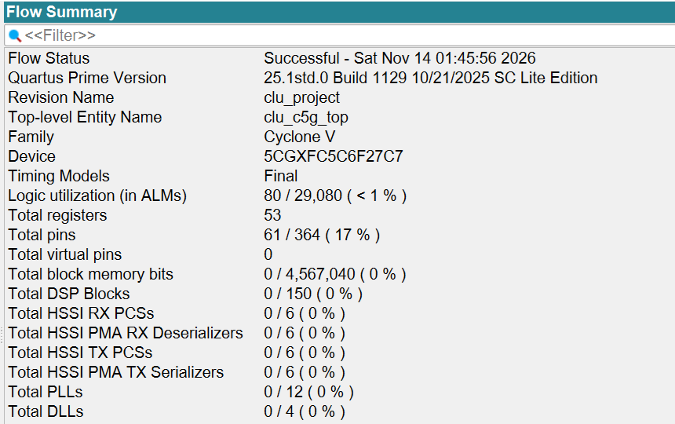

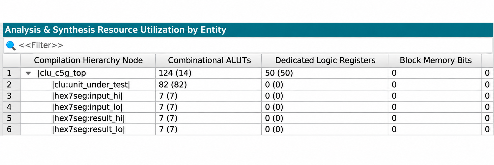

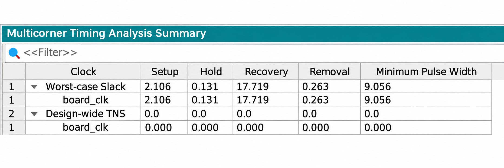

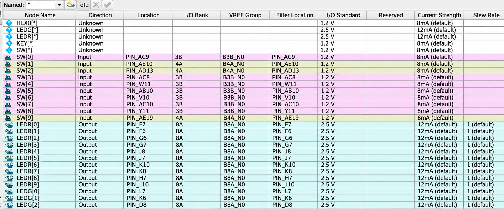

Complete pin locations and voltage standards are listed in `PIN_ASSIGNMENTS.md`
and in the machine-generated `clu_project.pin` report. All 61 locations are unique.

### Programming result

The USB-Blaster connection reported one compatible Cyclone V GX JTAG
device with ID 02B020DD. Quartus Programmer loaded
`output_files/clu_project.sof` in JTAG mode and reached **100% Successful**.
The system messages reported configuration succeeded, one device configured,
and successfully performed operations. The SOF checksum displayed in the
Programmer was **007B3C85**. This configures volatile FPGA memory; the design
must be loaded again after power is removed.

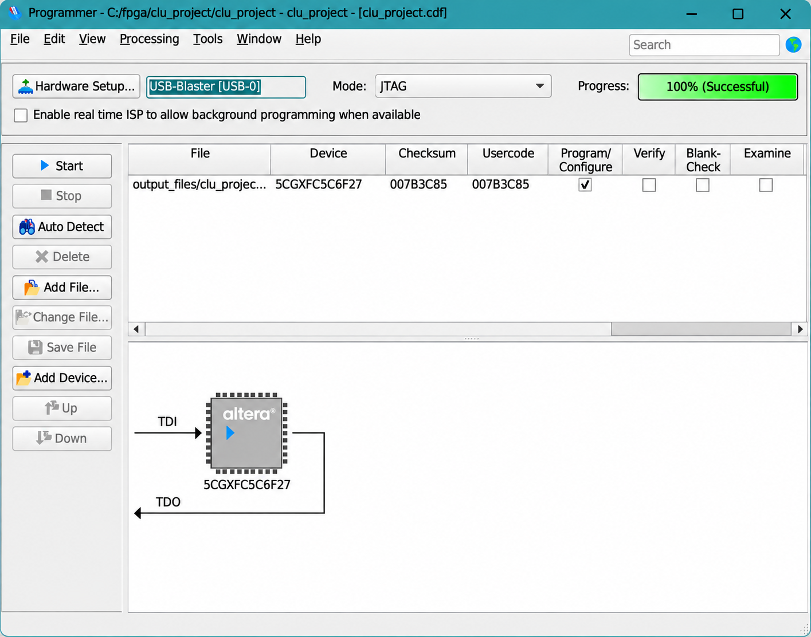

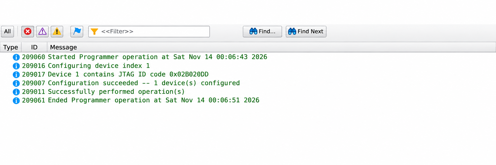

## 6. Results and demonstration

The following checks cover all eight operations and the main flag conditions.
Operands and results are hexadecimal. The tables list expected values; the board
result column is reserved for measurements taken during testing.

### 6.1 All operations with A = 13, B = 25 (hexadecimal)

A and B are loaded once. Only SW2..SW0 change between operations, and KEY2 loads
the selected OP. HEX1:HEX0 shows the result throughout the sequence.

**Setup**

1. Press and release KEY3 to reset the stored operands and OP.
2. Set SW7..SW0 to **00010011**, with SW4, SW1 and SW0 up and the others down.
   Press and release KEY0 to load **A = 13**.
3. Set SW7..SW0 to **00100101**, with SW5, SW2 and SW0 up and the others down.
   Press and release KEY1 to load **B = 25**.
4. Set SW9/SW8 to **00** to view A on HEX3:HEX2, **01** to view B,
   or **11** to view OP. Set each OP below, then press and release KEY2.

| SW2..SW0 | Operation | Expected HEX1:HEX0 | Expected flags | Board result |
|---|---|---|---|---|
| 000 | ADD | 38 | LT | 38 (photographed) |
| 001 | SUB | EE | C, N, LT | |
| 010 | AND | 01 | LT | |
| 011 | OR | 37 | LT | |
| 100 | XOR | 36 | LT | |
| 101 | CMP | 01 | LT | |
| 110 | PAR | 03 | LT | |
| 111 | ROL | 62 | LT | |

LT stays on throughout the sequence because A < B. Subtraction gives
13 - 25 = EE with eight-bit wraparound, setting C and N. Parity gives 03 because
both operands have three set bits. For rotation, B(2:0) = 101, so rotating A left
by five positions gives 62.

The flag LEDs are **LEDG0 = Z**, **LEDG1 = C**, **LEDG2 = N** and **LEDG3 = LT**.
LEDG6..LEDG4 show OP, while LEDG7 stays on. LEDR7..LEDR0 display the result in binary.

The photographs below show addition with the stored operands. HEX3 and HEX2 show
the selected input page, while HEX1 and HEX0 show the result 38. The other board
results can be recorded after testing each operation.

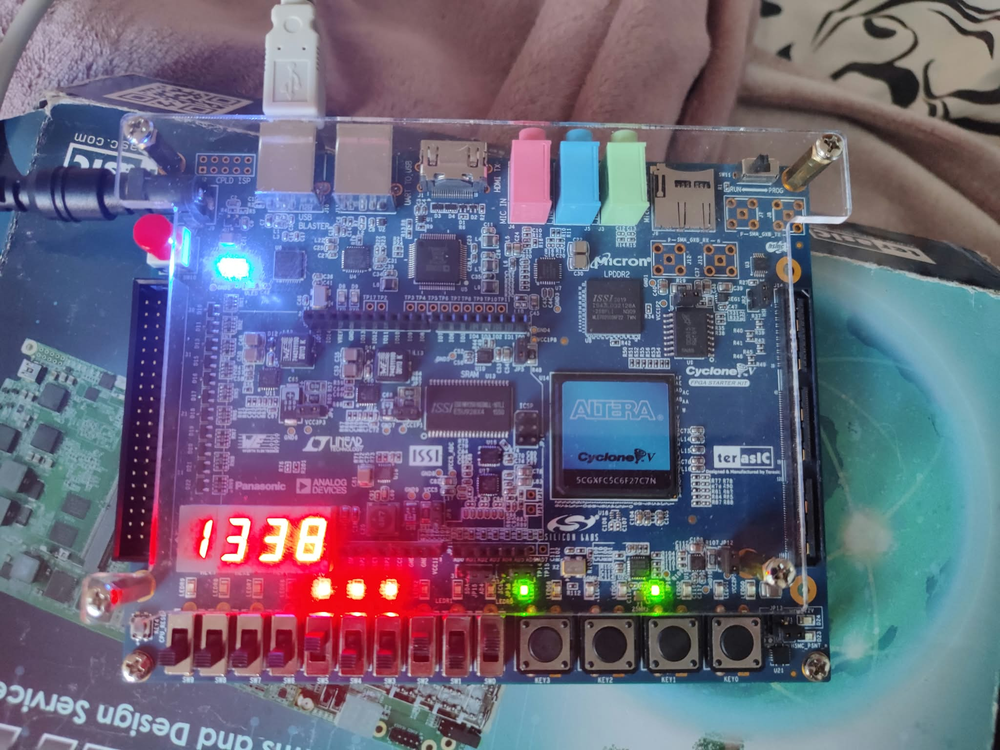

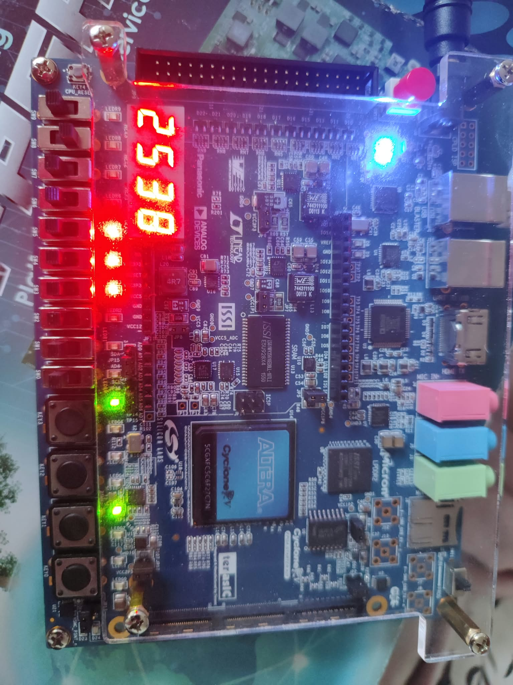

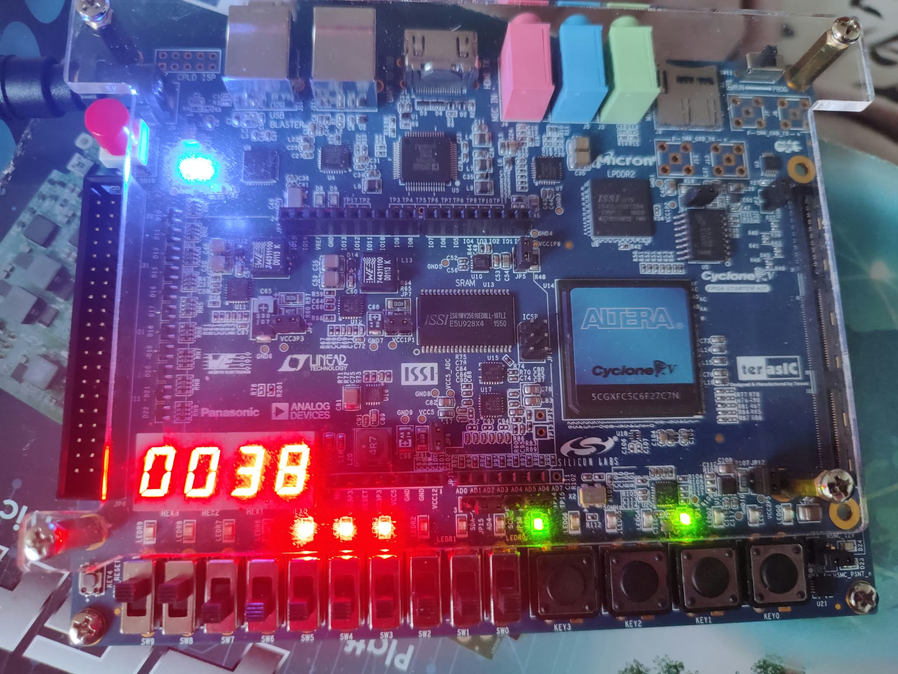

### 6.2 Demonstration video

loaded **A = 13** and **B = 25** and showed each operand
on HEX3:HEX2. Then select the operations in the order below. Press and release
KEY2 after each switch change.

| # | SW2 | SW1 | SW0 | Operation | Right digits | Flag LEDs on |
|---|---|---|---|---|---|---|
| 1 | Down | Down | Down | ADD | 38 | LEDG3 |
| 2 | Down | Down | Up | SUB | EE | LEDG1, LEDG2, LEDG3 |
| 3 | Down | Up | Down | AND | 01 | LEDG3 |
| 4 | Down | Up | Up | OR | 37 | LEDG3 |
| 5 | Up | Down | Down | XOR | 36 | LEDG3 |
| 6 | Up | Down | Up | CMP | 01 | LEDG3 |
| 7 | Up | Up | Down | PAR | 03 | LEDG3 |
| 8 | Up | Up | Up | ROL | 62 | LEDG3 |

The flag column lists LEDG0..LEDG3 only; LEDG7 stays on and LEDG6..LEDG4 indicate OP.
Show the result and flags for each operation. Keep the switches, displays and
LEDs visible in the recording.

The demonstration recording is included as [DEMO.mp4](../evidence/DEMO.mp4).

## 7. Discussion and conclusion

Simulation covers every binary input combination and all four status flags.
The design compiles for the C5G with positive timing margins at 50 MHz, and
synthesis reports zero CLU registers. The shared switch interface accepts full
8-bit operands. Switches must remain stable before a load, and the SOF must be
reloaded after a power cycle. Physical board tests and the video demonstration
remain to be completed.
